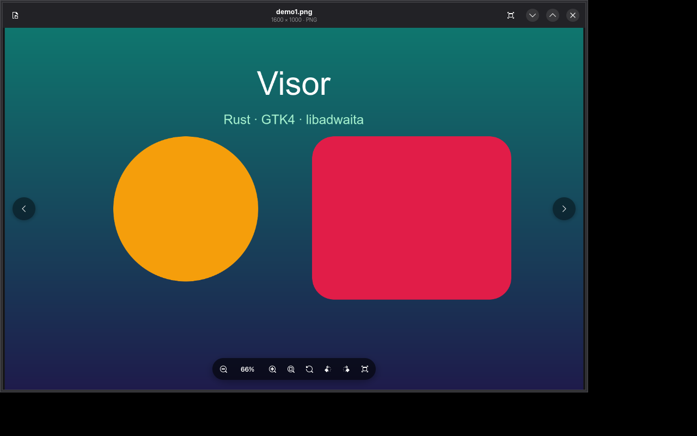

# Visor

Visor de imágenes minimalista para escritorio, escrito en Rust con GTK4 y
libadwaita. Interfaz estilo GNOME: cabecera con título y controles flotantes de
solo íconos.

## Características

- Abrir con `Ctrl+O`, desde la línea de comandos (`visor foto.png`) o
  arrastrando archivos y carpetas a la ventana.
- Navegación entre las imágenes de la misma carpeta con las flechas laterales o
  `←` / `→`.
- Zoom con rueda del ratón, paneo arrastrando, ajustar a la ventana y tamaño real.
- Rotación en pasos de 90°, pantalla completa y tema claro/oscuro automático.
- Formatos: PNG, JPEG, GIF, WebP, BMP, TIFF e ICO.

## Atajos

| Atajo | Acción |
| --- | --- |
| `Ctrl+O` | Abrir imagen |
| `←` / `→` | Imagen anterior / siguiente |
| `+` / `-` | Acercar / alejar |
| `Ctrl+0` | Ajustar a la ventana |
| `Ctrl+1` | Tamaño real (100 %) |
| `R` / `Shift+R` | Rotar a la derecha / izquierda |
| `F11` | Pantalla completa |
| `Esc` | Salir de pantalla completa / cerrar |

## Compilar y ejecutar

```sh
cargo build --release
./target/release/visor ruta/a/imagen.png
```

Requiere GTK 4.10+ y libadwaita 1.4+.


